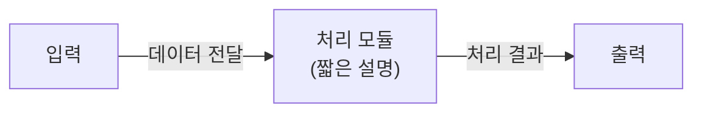

# 주제

> [!NOTE] 핵심 질문
>
> - 이 노트에서 설명할 핵심 질문
> - 구조·계산·실험에 관한 추가 질문

- 기록일:
- 갱신일:
- 관련 트랙 / 데이터셋 / 분할:
- 코드 기준 commit 또는 분석일:
- 실험일 / 보고일 / 실행 ID:
- 근거와 확인 범위:

> 템플릿 작성 안내: 실제 주제에 맞게 채우고, 안내 문장·아래 개념 예시·불필요한 절을 제거한다. 아래 도식과 식은 설명 형식 예시이며 프로젝트 구현 사실이 아니다.

## 핵심 발견

이번 지식이 답하는 질문과 발표에서 전달할 메시지를 적는다.

## 중요 개념

- **개념명**: 정의·역할·유사 개념과의 차이 요약

## 배경과 전제

현재 문제, 필요한 배경, 분석 범위와 가정을 적는다.

## 아키텍처 또는 실험 흐름

아래는 데이터 흐름 표기 예시다. 실제 모듈·shape·경계·전달 내용으로 교체한다.

화살표 의미, frozen/trainable 및 shared/local 범위를 설명한다. 제안 구조는 현재 구조와 구분한다.

## 계산과 수식

아래는 형식 설명용 일반 가중 평균이며 현재 구현 수식이 아니다. 분석 대상의 실제 수식으로 교체하거나 이 절을 제거한다.

$$
y = \sum_{i=1}^{n} \alpha_i x_i,
\qquad \sum_{i=1}^{n}\alpha_i=1.
$$

- $i$: 입력 인덱스, $1 \le i \le n$
- $n$: 입력 벡터 수
- $d$: 벡터 차원
- $x_i$: 입력 벡터, $x_i \in \mathbb{R}^{d}$
- $\alpha_i$: 합이 1인 정규화 가중치
- $y$: 출력 벡터, $y \in \mathbb{R}^{d}$

연산 축, 가정, mask/detach와 gradient 흐름을 실제 코드에 맞춰 설명한다.

## 실험 질문과 관찰

- **실험 질문**:
- **고정 조건 / 변경 변수**:
- **구현 사실**:
- **로그 관찰**:
- **원인 가설**:
- **개선 제안 / 다음 확인**:
- **해석 제한 / 미확인**:

해당하는 항목만 남긴다. 수치의 단위, 평가·checkpoint 선택 정책과 seed를 기록한다.

## 근거와 관련 자료

코드 경로·함수·commit, 로그/run ID, PDF 페이지, 원문 링크를 연결한다. 인용 근거를 확인하지 않은 주장은 미확인으로 표시한다.

## 확인 기록

- 코드·수식·도식·수치 대조:
- 문법·로컬 링크·UTF-8 확인:
- Mermaid / 수식 렌더 확인 여부:
- 갱신 이유:

## 작성 표현 확인
- 논문·명세·공식 문서에 있는 공식 용어 및 공식 약어만 사용한다. 자체적으로 만든 축약 표현은 쓰지 않는다.
- 실험 대상·방법·조건·목적을 풀어서 적는다. 의미가 분명할 때만 조사를 생략하고 단어를 나열한다.
- 코드 식별자는 정확히 인용하고 완전한 설명을 병기한다. 제목·표·도식·수식 설명에도 동일하게 적용한다.
