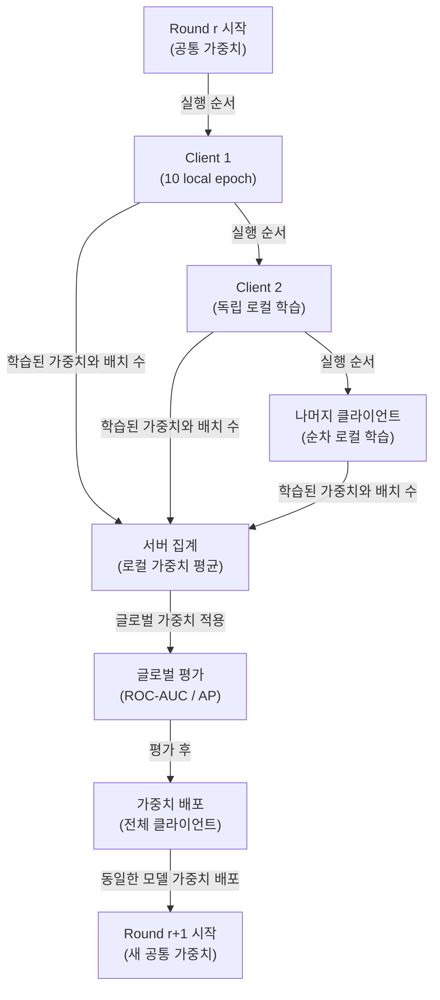

# 연합학습의 round와 client: 한 PC에서 FedAvg가 동작하는 방식

> [!NOTE] 핵심 질문
>
> - 로그의 `round`와 `client`가 의미하는 학습 단위는?
> - 순차 실행되는 클라이언트의 독립 학습 방식은?
> - 서버 집계 시점과 평균 대상은?
> - 다음 round에 배포되는 모델 가중치와 로컬 gradient의 차이는?

- 기록일: 2026-10-07
- 갱신일: 2026-10-07 (사용자 지정 세미나 양식 반영)
- 관련 트랙: 김배호 트랙의 PEL 비교를 위한 기존 FedAvg 실행 이해
- 범위: UCF event 13개 클라이언트, scene 9개 클라이언트, 기본 FedAvg·개인화 없음
- 코드 기준: `2981bbf9aee30a7b8cf85b85c1afed954f285917`, 2026-10-07 로컬 코드 확인
- 근거: 사용자 질의와 현재 `FedAvgServer`/`FedAvgClient` 구현. 실행 중인 리눅스의 commit 일치는 별도로 확인하지 않았다.

## 중요 개념

- **Client**: 데이터 loader·모델 복사본·AdamW optimizer·scheduler를 보유한 논리적 학습 주체; 한 프로세스 안의 클라이언트 객체
- **Local epoch**: 클라이언트별 로컬 학습 루프 1회; UCF 정상·이상 loader 중 짧은 쪽의 배치 수만큼 처리; 전체 로컬 영상의 1회 사용 보장 없음
- **Round**: 전체 클라이언트 로컬 학습 → 서버 집계 → 글로벌 평가 → 가중치 배포의 실행 단위; 매 round 전체 클라이언트 참여
- **Gradient**: mini-batch loss의 backward 결과; 로컬 optimizer 업데이트에 사용; 서버 직접 전달 없음
- **글로벌 가중치**: 로컬 학습 결과의 가중 평균; 다음 round 시작 전 전체 클라이언트에 동일하게 복사
- **순차 실행과 독립 학습**: client 1부터 순차 계산; 같은 round의 공통 출발 가중치 사용; 이전 client의 업데이트 인계 없음

## 한 round의 실행 순서

첫 round는 동일한 초기 모델의 deepcopy로 시작한다. 이후 round는 직전 round에서 배포받은 글로벌 가중치로 시작한다. 현재 본 실험의 `local_epochs=10`은 각 클라이언트가 자기 데이터로 10 local epoch 학습한다는 의미다.

실행 순서 화살표는 계산 순서만 표시하며 client 사이의 업데이트 전달은 없음. 서버 방향 화살표는 로컬 가중치와 집계용 배치 수 전달을 표시.

`FedAvgServer.train()`의 client loop는 실행 순서를 정한다. 모든 client의 `train()`이 반환된 뒤 `aggregate_parameters()`를 한 번 호출한다. 이후 서버 모델에 적용하고 평가한 다음 `send_global_parameter()`로 배포한다. 따라서 client 사이 또는 mini-batch 사이에 서버 집계가 일어나지 않는다. 클라이언트별 scheduler는 해당 로컬 학습이 끝난 뒤 round당 한 번 step한다.

## 현재 코드의 집계 수식

$$
W^{(r+1)} = \sum_{i=1}^{K}\alpha_i W_i^{(r)},
\qquad
\alpha_i = \frac{b_i}{\sum_{j=1}^{K}b_j}.
$$

- $r$: 글로벌 round 인덱스
- $i$, $j$: 참여 클라이언트 인덱스, $1 \le i,j \le K$
- $K$: 참여 클라이언트 수; UCF event 13, scene 9
- $W^{(r)}$: round $r$의 공통 출발점인 학습 가능한 모델 파라미터 집합
- $W_i^{(r)}$: client $i$의 로컬 학습 완료 파라미터; 같은 key·shape끼리 평균
- $W^{(r+1)}$: 로컬 파라미터 집계 후 다음 round에 배포할 글로벌 가중치
- $b_i$: `len(normal_loader) + len(anomaly_loader)`로 반환하는 **DataLoader 배치 수 합**; 원시 표본 수와 구별
- $\alpha_i$: 합이 1인 정규화 집계 계수; 모든 $b_i$가 같을 때 $1/K$

UCF의 한 local epoch에서 실제 optimizer step 수는 다음과 같다.

$$
S_i=\min(B_i^{N}, B_i^{A}),
\qquad
b_i=B_i^{N}+B_i^{A},
\qquad
\text{round당 로컬 step 수}=E S_i.
$$

- $S_i$: client $i$의 local epoch당 optimizer step 수
- $B_i^{N}$: 정상 loader 배치 수; `drop_last=True`
- $B_i^{A}$: 이상 loader 배치 수; `drop_last=True`
- $b_i$: 서버 집계에 사용하는 두 loader의 배치 수 합
- $E$: local epoch 수; 본 실험 10
- $E S_i$: round당 client $i$의 총 로컬 optimizer step 수

**집계에 쓰는 배치 수 합과 실제 로컬 step 수는 서로 다르다.** 정상·이상 데이터를 각각 한 배치씩 꺼내 결합한 뒤 한 번 backward/optimizer step을 수행한다. 이 노트는 기존 규약을 설명하며 가중 단위를 바꾸는 제안이 아니다.

## 가중치 배포와 optimizer 상태

`get_global_parameters()`는 `requires_grad=True`인 파라미터만 반환한다. 동결된 CLIP 파라미터는 평균 대상이 아니며, 고정 PEL 텍스트 bank도 집계 대상이 아니다. 개인화가 없는 현재 기본 FedAvg에서는 모든 학습 가능한 모델 파라미터를 집계한다.

`set_parameters()`는 모델의 파라미터 값을 복사하지만 optimizer를 다시 생성하지 않는다. 따라서 배포 직후 모델 가중치는 같아도 **각 클라이언트의 AdamW 모멘트와 step 상태는 유지**된다. 다음 로컬 업데이트는 자기 데이터와 자기 optimizer 상태에 따라 달라진다. 모든 클라이언트에 같은 gradient를 적용하는 동작으로 설명하면 안 된다.

## 로그 해석과 실험 범위

- **구현 사실**: `round 1, client: 1`은 해당 client의 로컬 학습 시작 표시다. 그 사이 mini-batch progress bar는 현재 구현에 없다.
- **사용자 로그 관찰**: event의 13개 client와 scene의 9개 client 출력 뒤 round ROC/AP가 나왔다. 이는 각 짧은 실행이 글로벌 평가까지 도달했다는 관찰이다. 이 노트에는 새 성능 실험을 추가하지 않았다.
- **본 학습 상태**: 사용자 대화상 event 기준의 20 round × 10 epoch 실행을 시작한 상황이다. 최종 완료나 성능 개선은 아직 확인하지 않았다.
- **비교 질문**: 같은 분할·seed·집계·예산에서 기준 MIL 기반 분류 손실과 MIL 기반 분류 손실+fixed-bank PEL을 비교한다. event 기준과 scene PEL을 직접 비교해 PEL 효과로 해석하지 않는다.
- **평가 정책**: round마다 집계한 글로벌 모델을 공통 test set에서 평가하며, UCF의 최고 ROC-AUC round를 best checkpoint로 선택하는 현재 재현 정책을 사용한다. 별도 validation 선택 완료를 의미하지 않는다.
- **해석 제한**: 한 PC의 시뮬레이션은 실제 여러 PC의 네트워크 통신, 지연 또는 데이터 반출 통제를 검증한 실험이 아니다. 논리적으로는 클라이언트별 loader만 사용하고 다른 client의 로컬 업데이트를 학습 도중 이어받지 않는다.

## 근거와 관련 자료

- [서버 코드](../../fed/server.py): `FedAvgServer.train`, `BaseServer.aggregate_parameters`, `set_global_parameter`, `send_global_parameter`, `evaluate`.
- [클라이언트 코드](../../fed/client.py): `FedAvgClient.__init__`, `train`, `get_global_parameters`, `set_parameters`.
- [데이터 로더](../../utils/dataset.py): `make_ucf_dataloader`, 정상·이상 loader와 `drop_last`.
- [고정 텍스트 PEL 실행 안내](../research/fixed-bank-pel-run.md).
- [두 트랙 경계](../research/two-track-scope.md), [현행 성능 목표](../README.md#현행-연구-목표와-성능-정의).

## 확인 기록

- 코드와 도식의 로컬 학습 → 집계 → 평가 → 배포 순서, 파라미터 반환 범위, 배치 수 집계식, optimizer 상태 보존을 대조했다.
- UTF-8, Markdown fenced block, 수식 delimiter, 상대 링크와 색인을 정적으로 확인했다.
- Mermaid 및 LaTeX의 실제 뷰어 렌더는 미검증이다.
- 갱신 이유: 핵심 질문 callout, 개조식 개념·기호 설명, 두 줄 Mermaid label, 발표 포인트·예상 질문 삭제 요청 반영
- 2026-10-13: 논문 용어로 손실 설명 정정; [용어 근거](../architecture/loss-terminology.md)
