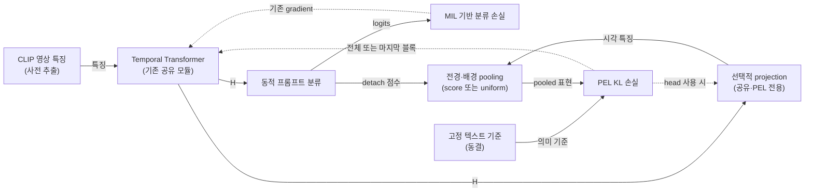

# PEL과 연합학습의 호환성 검증을 위한 5단계 실험 구현

> [!NOTE] 핵심 질문
>
> - PEL 손실과 기존 검출 손실의 충돌을 어떻게 측정할 것인가?
> - PEL의 강도·활성화 시점·pooling·적용 모듈을 어떻게 분리해서 비교할 것인가?
> - 여러 seed와 다른 집계 방법에서 개선의 반복성을 어떻게 확인할 것인가?

- 기록일: 2026-10-08
- 갱신일: 2026-10-13
- 변경 이유: 코드 함수명 대신 논문의 MIL 기반 분류 손실 설명으로 본문·도식 통일; [용어 근거](../architecture/loss-terminology.md)
- 관련 트랙 / 데이터셋 / 분할: 김배호 PEL 적용 지원 / UCF / event 13 clients·scene 9 clients
- 범위: 진단과 후보 코드 준비, 기본 FedAvg 보존, 후속 집계 연결의 명시적 opt-in
- 코드 기준: 2026-10-08 작업 트리; 새 옵션의 실제 데이터 학습 미실행
- 실험일 / 보고일: 기존 PEL event 2026-10-07, scene 2026-10-08; 전체 로그 보고 2026-10-08; event 기준 실제 실행일 미확인
- 근거: [원인 진단·개선 계획](../plans/active/2026-10-08-pel-federated-compatibility.md), [기존 4개 결과](../research/2026-10-08-ucf-event-scene-results.md), 관련 코드·CPU 합성 검증

## 핵심 발견

- **2026-10-14 실제 진단 갱신**: event 기준 run002 완료; [수식·상쇄 관찰 및 한계](2026-10-14_손실경쟁과_업데이트상쇄_진단.md), [실험 기록](../experiments/2026-10-13_ucf_event_baseline_run002.md). PEL/scene 진단 미완료로 1단계 전체 완료와 구분.

- **구현 사실**: PEL의 의미 정렬 대상은 고정 텍스트 기준; 학습 대상은 기존 시각 표현과 선택적으로 추가한 projection head
- **구현 사실**: 기존 PEL 계수 1.0은 손실의 배율; 서버가 평균하는 별도 PEL 파라미터라는 해석과 구분
- **관찰**: event 최고 ROC +0.92%p, scene 최고 ROC -0.17%p; 두 분할의 마지막 ROC/AP 하락
- **가설**: 손실 방향 경쟁, 점수 기반 전경 선택, 클래스 편향, 클라이언트 업데이트 상쇄
- **미확인**: 어떤 가설이 실제 성능 차이를 설명하는지, 새 후보의 성능 개선 여부
- **실험 원칙**: 원인 측정 → 한 요인씩 변경 → 반복성 확인 → 집계별 off/on 비교

## 중요 개념

- **MIL 기반 분류 손실**: Fed-WSVAD의 기존 영상 단위 다중 클래스 MIL 분류 손실
- **fixed-bank PEL**: 전경·배경 시각 표현을 전체 고정 텍스트 기준에 정렬하는 이식 변형; 원본 PEL4VAD 전체 재현과 구분
- **텍스트 사전**: 기본 UCF 14개 클래스 이름; 실제 새 실행에 설명형 사전 입력이 없으면 지식 기반 문구 확장으로 표기 금지
- **gradient cosine**: 같은 시각 모듈에서 두 손실의 미분 방향 일치도; 음수는 국소 방향 경쟁의 단서
- **client delta**: 같은 round 시작 모델 대비 로컬 학습 후 파라미터 차이; 파라미터 자체의 cosine과 구분
- **warmup·ramp**: PEL을 끈 초기 구간과 계수를 점진적으로 증가시키는 구간
- **last-block routing**: MIL 기반 분류 손실의 기존 gradient 유지, PEL gradient만 마지막 Temporal 블록과 선택적 head로 제한
- **projection head**: PEL 계산용 공유 선형 변환; 검출 logits 경로에서는 미사용, 시각 표현 H로 역전파 유지
- **paired seed**: 같은 seed·같은 분할·같은 학습 조건의 기준/후보 차이; round를 반복 표본으로 사용 금지

## 배경과 전제

- 기존 4개 실행의 공통 조건: UCF, AdamW, LR 0.0001, 20 rounds × 10 local epochs, normal/anomaly loader 각각 batch 64, seed 88888888
- 기본 집계: 기존 loader 배치 수 합에 따른 FedAvg; server optimizer·개인화·local policy none
- 평가: 글로벌 공통 test의 프레임 ROC/AP; 최고 ROC round 선택은 탐색·재현용이며 독립 validation 선택과 구분
- event: 로컬 실제 이상 이벤트 하나와 Normal, 텍스트 후보는 전체 14개
- scene: 장면 유형별 기존 데이터 소유 경계, 여러 이벤트 가능; 동일 물리 카메라로 확정 불가
- 데이터 이동·새 분할·호스트 CUDA 변경·실제 학습 실행 없음

## 전체 구조

아래 도식은 구현된 선택적 후보 경로. 실선은 데이터 전달, 점선은 gradient 범위 설명.



- head 미사용: H를 그대로 pooling에 전달
- score 미분: detach로 차단; 전경 선택의 정확성 자체를 보장하는 기능과 구분
- 최종 추론: 기존 동적 프롬프트·1-P(Normal); PEL bank·영상 정답 불필요
- projection checkpoint: `pel_projection.weight` 추가; inference에서 동일 `--pel_projection` 옵션 필요

## 5단계의 실험 질문과 구현

| 단계 | 실험 질문 | 코드·옵션 | 실제 학습 상태 |
| --- | --- | --- | --- |
| 1. 진단 | 손실과 client 업데이트가 서로 충돌하는가? | `--pel_diagnostics`, `utils/pel_diagnostics.py` | 미실행 |
| 2. 강도·시점 | 계수 1.0이나 초기 선택이 문제인가? | weight 0.1/0.3, `--pel_warmup_rounds`, `--pel_ramp_rounds` | 미실행 |
| 3. pooling·적용 위치 | 구간 선택·빈도 편향·표현 변경 범위가 문제인가? | uniform/batch balance/last_block/projection | 미실행 |
| 4. 반복성 | 선정 후보의 이득이 seed마다 유지되는가? | 명령 생성·paired summary 도구 | 미실행 |
| 5. 집계 결합 | 같은 PEL이 집계별로도 유효한가? | 명시적 integration 옵션, 기존 FedNova/FedPGP 경로 | 미실행 |

### 1단계 — 손실·업데이트 진단

- 구현: 동일 forward에서 `autograd.grad`로 손실 미분 분리, 실제 optimizer gradient를 덮어쓰지 않는 측정
- 측정 범위: rounds 1/5/10/15/20의 client별 첫 epoch 첫 batch; 매 round의 공유 파라미터 delta
- 저장: 실행 폴더의 `pel_diagnostics.jsonl`; 클래스 사용 횟수·steps·평가 곡선은 `round_metrics.jsonl`로 연결
- 항목: norm·cosine·계수 적용 후 비율, client pair cosine, 집계 보존 비율, pooling entropy·최대 weight, 목표 텍스트 cosine·클래스별 KL
- 제한: 마지막 블록 후보의 raw loss gradient와 실제 라우팅 gradient 구분; 로그에 scope 및 측정 의미 표시
- 비용: 추가 backward graph traversal·CPU double delta 계산·동기화; 실제 RTX3090 비용 미측정
- 해석: 0 norm의 cosine·비율은 null; 수치 상쇄와 유용한 특징 소실의 인과관계는 별도 검증 대상

### 2단계 — 강도·활성화 시점

- P1: 고정 weight 0.1, P2: 고정 weight 0.3; 기존 P0 weight 1.0과 비교
- P3: 선정 weight, rounds 1–3 PEL 0, rounds 4–6 선형 증가, round 7 이후 유지
- 구현: 각 서버가 1-based round를 client에 전달, `scheduled_weight()`로 실제 계수 결정
- 기록: `active_pel_weight`; warmup의 base loss만 backward, 사용하지 않는 head의 gradient 생성 없음
- 비교 순서: P1 event/scene → P2 event/scene → 선정 강도의 P3 event/scene
- 고정: temperature 0.09, 동일 사전·집계·seed·예산; 여러 요인 동시 변경 금지

### 3단계 — pooling·빈도·모듈

- **uniform pooling**: 유효 snippet의 균등 평균; score 선택 의존성 진단용, 전경·배경이 같은 표현이 되는 한계
- **batch class balance**: PEL target row별 현재 batch 빈도의 역수, 평균 1로 정규화; 해당 batch의 관측 클래스만 사용, 데이터셋 전체 빈도 보정과 구분
- **last_block**: base loss 정상 backward + 마지막 Temporal 블록의 PEL gradient 합산; 앞 블록·위치 임베딩에는 PEL gradient 제외
- **projection**: 동일 차원의 identity-initialized linear head, RNG 보존, 공유 파라미터로 기존 집계 적용, 글로벌 검출 시 head 미사용
- head-only 학습 금지: PEL gradient의 H 경로 유지
- checkpoint 호환성: 기본 head off의 state key 유지; head on은 새 key를 가진 별도 후보, 기존 checkpoint와 strict load 정책 구분
- 제한: class balance는 PEL 항만 변경; sampler·MIL 기반 분류 손실·집계 계수 유지

### 4단계 — 반복 seed와 결과 취합

- 반복 seed: 42, 2026 추가; 선정 후보의 88888888 결과와 합쳐 총 3개 paired seeds
- 명령 생성: `scripts/prepare_pel_experiments.py`; subprocess 호출·학습 실행 기능 없음
- 결과 취합: `scripts/summarize_pel_runs.py`; 기존 manifest·round JSONL만 읽기
- 출력: 최고 ROC·선택 AP·독립 최고 AP·최종 ROC/AP, seed별 delta·평균·표본 표준편차
- 결측 처리: 짝 없는 seed 명시, 한 seed 표준편차 null, 같은 조건의 중복 seed 오류
- 주의: 학습 코드·데이터 식별값 일치 확인은 기록 원본에서 별도 수행; 통계 파일만으로 재현성·유의성 확정 금지

### 5단계 — 집계별 교차 비교

- 명시적 활성화: `--pel_allow_aggregation_integration`; FedNova/FedPGP에서만 허용
- 연결 내용: 기존 strategy client에 fixed-bank PEL 손실·schedule·routing 옵션 전달, 서버에서 동일 bank 공유
- 보존: `fed/aggregation.py`, 집계 식·loader 배치 수 계수·FedNova local steps·서버 optimizer·기존 공유/로컬 정책
- FedPGP: 기존 로컬 adapter 유지, projection은 새 공유 모듈; global 평가와 개인화 proxy 구분
- 대조군: 각 집계에서 동일 설정의 PEL off / 선정 PEL on; `use_fedpgp_contrastive`는 이번 교차 비교에서 off
- 산출물: opt-in 실행의 round metrics·최종 checkpoint·summary 추가; 기본 집계 트랙 실행은 추가 로그 옵션 off
- 제한: 기존 AdamW 기반 FedNova 구현 활용; 원논문의 모든 이론 조건을 재현했다고 표기 금지
- 상태: 연결 코드·CPU 합성 검증 범위; 실제 Model의 low-rank adapter 상태 보존 확인, pretrained CLIP·Linux GPU 결합 성능 미확인

## 계산과 수식

### PEL 계수 schedule

$$
\lambda_r = \lambda_*\begin{cases}
0, & r\le w,\\
\min((r-w)/q,1), & r>w,\ q>0,\\
1, & r>w,\ q=0.
\end{cases}
\qquad L=L_C+\lambda_r L_P.
$$

- $r$: 1-based global round
- $w$: 초기 PEL 비활성 round 수
- $q$: 선형 증가 round 수
- $\lambda_*$: 목표 PEL 계수
- $L_C$: 기본 MIL 기반 분류 손실 손실; 통합 경로에서는 기존 추가 정규화 항 포함 가능
- $L_P$: fixed-bank PEL KL 손실
- $L$: optimizer에 사용하는 결합 손실

### 손실 방향과 집계 보존

$$
c=\frac{g_C^\top g_P}{\|g_C\|_2\|g_P\|_2},
\qquad \Delta_i=\theta_i-\theta_0,
\qquad R=\frac{\|\sum_i a_i\Delta_i\|_2}{\sum_i a_i\|\Delta_i\|_2}.
$$

- $g_C,g_P$: 동일 공유 모듈에서 base·PEL 손실의 펼친 gradient
- $c$: 두 gradient의 cosine; 어느 한 norm이 0이면 null
- $i$: 참여 client 인덱스
- $\theta_0$: 해당 round 시작의 공유 파라미터
- $\theta_i$: client 로컬 학습 후 공유 파라미터
- $\Delta_i$: 공통 시작점 대비 client 업데이트
- $a_i$: 기존 loader 배치 수 합으로 정규화한 FedAvg 계수, 합 1
- $R$: FedAvg 업데이트 보존 비율; 분모 0이면 null
- 적용 범위: 현재 진단은 plain FedAvg 전용; FedNova 정규화 업데이트에 그대로 적용하는 식과 구분

### 마지막 블록의 gradient 라우팅

$$
g(\theta)=\begin{cases}
\nabla_\theta L_C+\lambda_r\nabla_\theta L_P,&\theta\in S,\\
\nabla_\theta L_C,&\theta\notin S.
\end{cases}
$$

- $\theta$: 학습 가능한 파라미터
- $S$: 마지막 Temporal 블록 및 선택적 projection 파라미터 집합
- $g(\theta)$: optimizer에 전달하는 실제 gradient
- $\nabla_\theta$: 해당 파라미터에 대한 미분
- gradient와 optimizer update의 차이: 기존 AdamW moment·weight decay·학습률에 따른 후속 변환

### batch 클래스 기여 정규화

$$
v_j=\frac{1/n_{y_j}}{\frac1M\sum_{k=1}^{M}1/n_{y_k}},
\qquad L_P=\frac1M\sum_{j=1}^{M}v_j\ell_j.
$$

- $M$: 전경 row와 이상 영상 배경 row를 합친 PEL 정렬 항 수
- $j,k$: 정렬 row 인덱스
- $y_j$: row의 목표 클래스; 이상 배경은 Normal
- $n_{y_j}$: 현재 target rows에서 목표 클래스의 출현 횟수, 해당 row에 대해 항상 양수
- $v_j$: 평균 1로 정규화한 역빈도 row 계수
- $\ell_j$: row별 전체 클래스 KL 합; 기존 softened one-hot 목표 유지

## 사용법과 실행 경계

아래 명령은 학습 명령 목록의 JSON 생성용. `train.py` 실행과 구분.

```bash
python scripts/prepare_pel_experiments.py --stage strength
python scripts/prepare_pel_experiments.py --stage timing --selected-weight 0.3
python scripts/prepare_pel_experiments.py --stage pooling --selected-weight 0.3
python scripts/prepare_pel_experiments.py --stage modules --selected-weight 0.3
python scripts/prepare_pel_experiments.py --stage repeat --selected-weight 0.3
python scripts/prepare_pel_experiments.py --stage integration --selected-weight 0.3
```

- 위 0.3: 도구 입력 예시; 성능으로 선정된 값이라는 의미 없음
- `repeat`·`integration`: 실제 선정한 pooling·schedule·모듈 옵션을 `--selected-options="--pel_warmup_rounds 3 --pel_ramp_rounds 3"`처럼 함께 전달
- 기준 명령: 선정 PEL 전용 옵션 미추가; 집계·개인화 조건은 해당 후보와 동일
- 결과 기록: [record-experiment-results](../../.agents/skills/record-experiment-results/SKILL.md), 표 출력: [export-cvpr-results](../../.agents/skills/export-cvpr-results/SKILL.md)

## 근거와 관련 자료

- [5단계 구현·계획](../plans/active/2026-10-08-pel-federated-compatibility.md)
- [진단](../../utils/pel_diagnostics.py), [schedule·gradient routing](../../utils/pel_experiments.py), [pooling·KL](../../utils/fixed_pel.py)
- [모델·공유 상태](../../utils/model.py), [client](../../fed/client.py), [server](../../fed/server.py), [변경하지 않은 집계](../../fed/aggregation.py)
- [명령 생성](../../scripts/prepare_pel_experiments.py), [paired 취합](../../scripts/summarize_pel_runs.py)
- [기존 분할·PEL 노트](2026-10-08_event와_scene_분할_및_PEL_적용비교.md), [현행 목표](../README.md), [트랙 경계](../research/two-track-scope.md)

## 확인 기록

- 코드·수식·도식: schedule 경계·gradient routing·공유 head·집계 연결·통계 결측 처리와 정적 대조
- 자동 검증: `python -m unittest discover -s tests -v`, CPU 합성 단위·회귀 테스트 20개 통과; 실제 학습 실행과 구분
- 로컬 링크·UTF-8·fence·수식 delimiter: 정적 검사 통과; Python 소스 9개 문법·`git diff --check` 통과
- 집계 보존: `git diff --exit-code -- fed/aggregation.py` 통과, 집계 파일 변경 없음
- Mermaid·수식 렌더: 실제 뷰어 렌더 미검증
- 미확인: 실제 데이터 성능·GPU 비용·3-seed 반복성·독립 validation 선택·실제 adapter 통합 성능
- 갱신 이유: 사용자 요청에 따른 진단 이후 후보 코드 준비와 5단계 핵심 개념 기록
