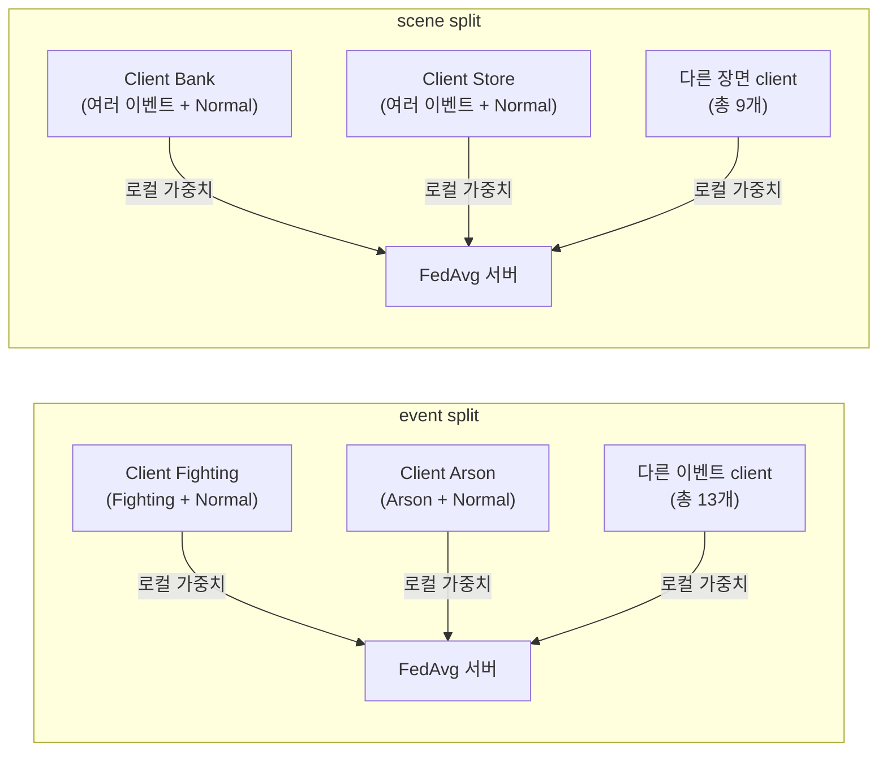
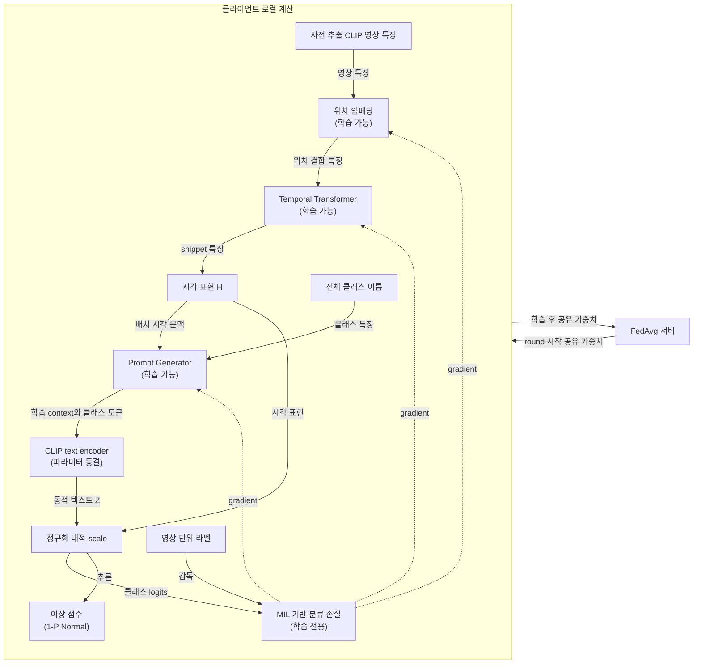
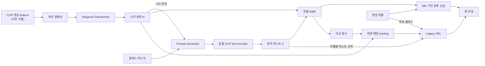
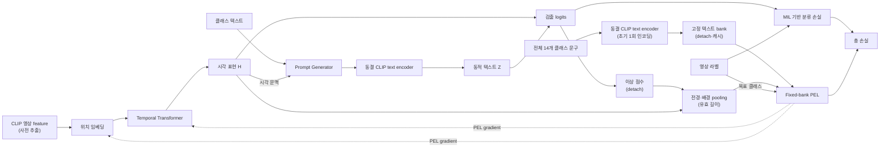
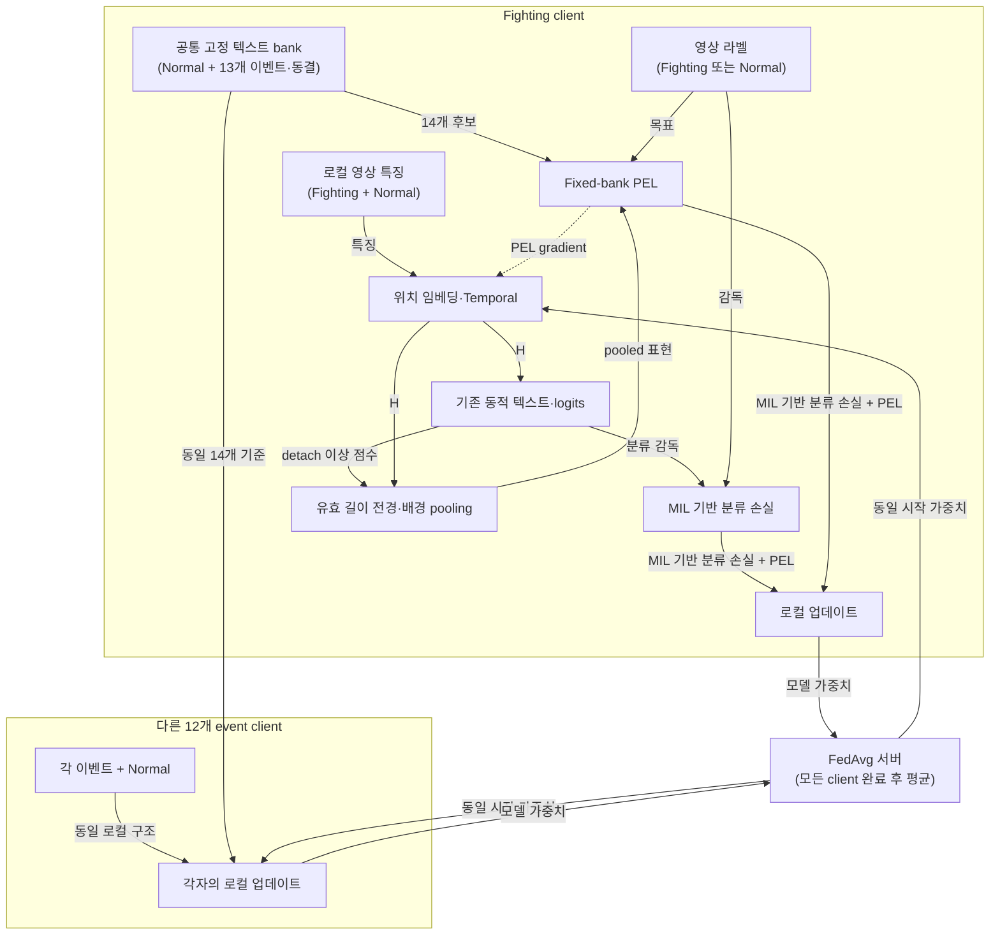
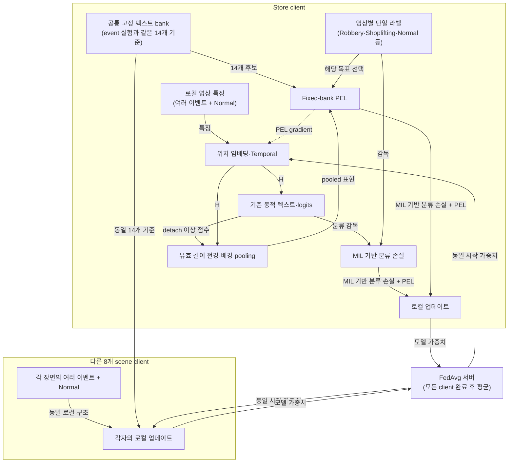

# event·scene의 연합 구조와 기존·현재 PEL 적용 비교

> [!NOTE] 핵심 질문
>
> - event와 scene에서 클라이언트가 소유하는 데이터와 로컬 학습의 차이는?
> - 김배호 트랙의 단일 이벤트 PEL 진단과 현재 연합 PEL 실험의 차이는?
> - 고정 전체 클래스 텍스트 기준이 바꾸는 대조 후보와 gradient 경로는?
> - 기존 Fed-WSVAD의 어느 출력에 PEL을 연결하고 어떤 모듈을 학습하는가?

- 기록일: 2026-10-08
- 갱신일: 2026-10-12 (기준·legacy·사용자 event/scene 구조도 비교 보완)
- 범위: UCF event/scene, 기본 FedAvg, MIL 기반 분류 손실 + fixed-bank PEL 비교
- 코드 기준: 2026-10-12 작업 트리의 모델·loss·client 확인; 최초 분석 commit `2981bbf9aee30a7b8cf85b85c1afed954f285917`과 구분; 실제 Linux 실행 commit 미확인
- 근거: 코드·분석 문서, 사용자 제공 클래스 분포 및 4개 실행 전체 round 로그; Linux 원본 manifest·checkpoint 직접 확인은 미실행
- 용어 해석: 요청의 “event, client”는 앞서 완료한 event·scene 실험으로 해석; client는 두 분할 모두의 로컬 학습 주체
- 그림 범위: 완료된 비교 실험의 PEL off / fixed-bank weight 1.0, temperature 0.09; 이후 준비한 projection·warmup·last_block 후보는 제외

## 중요 개념

- **Event split**: 이상 이벤트별 데이터 소유 경계; 13개 client에 각각 하나의 이상 이벤트와 Normal 할당
- **Scene split**: 장면 유형별 데이터 소유 경계; Store·Street 등 9개 유형에 여러 단일 라벨 이벤트 영상과 Normal 할당; 동일한 물리 장소·카메라 보장 없음
- **Non-IID**: 클라이언트 간 클래스 종류·빈도·데이터량·장면 분포의 차이; event와 scene에서 서로 다른 편향
- **다중 이벤트 로컬 데이터**: 한 client에 여러 종류의 단일 라벨 영상 보유; 한 영상의 다중 라벨과 구별
- **전체 텍스트 기준**: 13개 이상 이벤트와 Normal, 총 14개 의미 임베딩 공유; 다른 client의 원본 영상 반입과 구별
- **Legacy PEL**: 동적 텍스트와 배치 내 선택 쌍의 KL 정렬; 시각·프롬프트 양쪽으로 gradient 전달
- **Fixed-bank PEL**: 동결 CLIP의 고정 기준에 시각 표현 정렬; 전체 클래스 denominator 및 PEL 선택 점수 detach

## 분할별 연합학습 구조

| 항목 | event | scene |
| --- | --- | --- |
| Client 기준 / 수 | 이상 이벤트 / 13 | 장면 / 9 |
| 로컬 데이터 | 단일 이상 이벤트 + Normal | 여러 이상 이벤트 + Normal |
| 시스템 전체 분류 클래스 | UCF 14개 | 같은 14개 |
| 주요 로컬 편향 | 이벤트별 label 편향 | 장면·클래스 비율·데이터량 편향 |
| 서버 동작 | 전체 client 순차 학습 후 FedAvg | 동일한 학습·집계 규칙 |
| 데이터 소유 | 각 event CSV 유지 | 각 scene CSV 유지 |

화살표는 로컬 모델 가중치의 서버 전달을 표시. 원본 feature의 client 사이 이동 없음. 두 서버는 분할별 별도 실험을 표현하며 함께 집계하지 않음. 각 실험은 한 PC에서 client를 순차 계산하고 round당 한 번 평균·평가·배포.

사용자 제공 분포에서 Bank는 Robbery·Burglary·Assault·Fighting 등, Factory는 Explosion·Burglary·Vandalism, Store는 13개 이상 이벤트를 보유. Scene도 클래스 균등 또는 매 batch의 모든 이벤트 출현을 보장하지 않음. 현재 batch sampler 변경 없음.

장면별 소유 경계는 지자체 CCTV 환경의 도메인·사건 분포를 검토하는 모사 조건. 실제 지자체·카메라 단위 또는 엄격한 장면 비중복 검증으로 단정 불가. CSV별 중복·누수·분할 pool의 정확한 일치는 별도 확인 대상.

현재 loader는 장면을 새로 판별하지 않고 유형별 CSV 목록을 사용. 원래 장면 annotation의 수동·자동 생성 방식은 이 저장소에서 미확인.

## 고정된 집계와 서로 다른 로컬 학습

$$
W^{(r+1)}=\sum_{i=1}^{K}\frac{b_i}{\sum_{j=1}^{K}b_j}W_i^{(r)}.
$$

- $r$: 글로벌 round 인덱스
- $i$, $j$: 참여 client 인덱스
- $K$: event 13, scene 9
- $W_i^{(r)}$: 공통 출발점에서 로컬 학습을 마친 client $i$의 학습 가능한 파라미터
- $W^{(r+1)}$: 평균 후 다음 round에 배포할 글로벌 가중치
- $b_i$: 정상·이상 DataLoader 배치 수 합; 원시 영상 수 또는 실제 step 수와 구별

집계 수식은 같아도 데이터량에 따른 계수와 로컬 step 수는 분할마다 변화. 따라서 PEL 효과는 event 기준↔event PEL, scene 기준↔scene PEL로 비교. Event와 scene의 절대 점수 차이를 PEL 효과로 해석하지 않음.

## 기존 실험(김배호 진행) 및 현재 실험 설계 비교

기존 단일 이벤트 실험은 `scripts/experiment_pel4vad_client.py`의 standalone 로컬 진단을 기준으로 설명. 김배호 트랙에는 별도의 CCTV 6-client FedAvg/FedPGP 연합 로그도 존재하므로 모든 과거 실험을 단일 client로 묶지 않음. 개별 실행자의 확정은 코드·로그만으로 불가.

| 항목 | 기존 단일 이벤트 진단 | 현재 사용자 실험 |
| --- | --- | --- |
| 실행 단위 | 서버 없는 standalone 모델 | FedAvgServer와 여러 FedAvgClient |
| 데이터 | 지정 이벤트 하나 + Normal | UCF 전체 event 또는 scene client |
| 분류 dictionary | 2개 | 전체 14개 |
| 로컬 이벤트 인덱스 | 이상 영상 index 1 고정 | 영상별 실제 one-hot 라벨에서 인덱스 선택 |
| PEL 기준 | 시각 문맥에 따라 변하는 동적 텍스트 | 동결 CLIP으로 한 번 생성한 고정 텍스트 |
| PEL 후보 | 배치에서 선택한 텍스트의 반복 쌍 | 모든 고유 클래스 기준, 배치 미등장 클래스 포함 |
| PEL 행렬 | M × M | M × 14 |
| 선택 점수 | logits gradient 유지 | logits detach |
| PEL gradient | Temporal·위치·Prompt Generator | Temporal·위치만 |
| PEL 유효 길이 | pooling mask 없음 | 유효 길이 mask 적용 |
| 글로벌 집계 | 없음 | 기존 배치 수 가중 FedAvg |
| 평가 | 두 클래스 출력으로 전체 test 평가 | 전체 클래스 출력의 글로벌 test 평가 |

두 방식 모두 검출 감독으로 기존 Fed-WSVAD MIL 기반 분류 손실 유지. 현재 방식에서 Prompt Generator가 완전히 동결된 것은 아님. MIL 기반 분류 손실 경로에서는 기존대로 학습하고 PEL 경로만 차단. Temporal/프롬프트 내부의 기존 padding 동작은 유지하며 새 pooling만 유효 길이 적용.

기존 CCTV FedPGP+PEL 연합 실행은 전체 dictionary를 제공하지만 legacy PEL denominator는 배치에서 선택된 클래스 쌍만 포함. 로컬 adapter 등 추가 조건도 존재하므로 현재 기본 FedAvg fixed-bank 실험과 직접 동등 비교 불가. 기존 기본 FedAvg의 PEL flag 누락은 현재 기본 서버에 직접 전달하는 방식으로 수정.

## PEL을 연결한 기존 모델의 위치

### 네 구조의 비교 지도

| 구조 | PEL 연결 위치 | 의미 기준 | PEL이 학습하는 모듈 | 서버 |
| --- | --- | --- | --- | --- |
| Fed-WSVAD 기준 | 없음 | 검출용 동적 텍스트만 사용 | 해당 없음; MIL 기반 분류 손실이 시각·프롬프트 학습 | 사용자 기준은 기본 FedAvg |
| 기존 standalone legacy PEL | Temporal 출력 H의 보조 손실 분기 | Normal·지정 이벤트의 동적 텍스트 | Temporal·위치·Prompt Generator | 없음 |
| 사용자 event PEL | 각 event client의 H에 fixed-bank 손실 | 모든 client가 같은 고정 14개 기준 사용 | Temporal·위치; MIL 기반 분류 손실의 프롬프트 학습 유지 | 기존 FedAvg |
| 사용자 scene PEL | 각 scene client의 H에 같은 fixed-bank 손실 | event와 동일한 고정 14개 기준 | event와 동일 | 기존 FedAvg |

- **핵심 차이**: event와 scene의 PEL 연결 위치·손실 구현은 동일, client별 실제 영상의 클래스·장면 분포만 다름
- **PEL 의미**: Temporal 뒤에 새 검출 네트워크 삽입이 아닌 학습용 보조 정렬 분기
- **기존 PEL 범위**: 아래 legacy 그림은 저장소의 기존 이식·standalone 실험; 원본 PEL4VAD의 TCA·이진 검출기 전체 아키텍처와 구분
- **기준 범위**: 아래 Fed-WSVAD 그림은 이번 사용자 비교의 plain FedAvg·개인화 none 조건; 다른 개인화 설정의 전체 구조를 대표하는 그림과 구분

### 기존 Fed-WSVAD 기준 구조 — PEL off

- 실선: 특징·감독·가중치 전달; 점선: 학습 gradient의 도달 모듈
- CLIP text encoder 파라미터 동결과 Prompt Generator 입력 미분의 유지 구분
- 입력 CLIP 영상 특징: 사전 추출 파일, 로컬 loop에서 영상 encoder 재학습 없음
- 실제 추론: 라벨·MIL 기반 분류 손실 미사용; 동적 텍스트 경로는 계속 사용
- 공유 대상: 학습 가능한 시각·프롬프트 파라미터; PEL 손실·고정 bank 없음

**적용 지점은 CLIP feature 다음의 Temporal Transformer 출력 H.** 기존 검출 경로를 유지하고 H에서 전경·배경 의미 정렬 손실로 분기. Temporal 중간에 새 Transformer를 삽입하거나 CLIP encoder·서버 집계를 PEL 모듈로 교체한 구조가 아니라, 클라이언트 학습 손실에 추가한 보조 분기.

| 위치 | 기존 Fed-WSVAD 역할 | PEL에서 재사용하는 내용 |
| --- | --- | --- |
| 입력 `.npy` feature | 사전 추출한 CLIP 영상 특징 | 기존 입력 그대로, 재추출 없음 |
| `Model.encode_video()` | 위치 임베딩 추가 후 Temporal Transformer | snippet별 시각 표현 H |
| `Model.encode_text_prompt()` | H의 시각 문맥과 클래스 특징으로 동적 프롬프트 생성 | legacy에서 동적 텍스트 Z 사용; 현재 PEL 기준으로는 미사용 |
| `Model.forward()` | 정규화 H와 동적 Z의 유사도 logits 계산 | logits에서 pooling용 이상 점수 계산 |
| `return_pel4vad_aux=True` | H와 Z를 보조 출력으로 반환 | loss에 H 전달; legacy에서는 Z도 전달 |
| 로컬 학습 loss | 기존 MIL 기반 분류 손실로 검출 감독 | MIL 기반 분류 손실 + weight × PEL로 합산해 backward |

- **H shape**: B × T × 512; B는 결합 영상 batch, T는 처리된 snippet 길이
- **Z shape**: C × 512; C는 검출 클래스 수, 현재 UCF 14
- **Logits shape**: B × T × C; 영상별·snippet별 클래스 유사도
- **손실 적용 위치**: `FedAvgClient.training_loss()`; standalone 진단은 해당 스크립트의 학습 루프
- **추론 경로**: 기존 H·동적 Z·logits·이상 점수 유지; PEL pooling·KL·영상 정답 라벨 사용 없음

### 기존 legacy PEL 연결

아래 구조는 기존 standalone의 Normal + 지정 이벤트 조건. 기존 Fed-WSVAD 검출 경로에서 H·Z·logits를 꺼내 PEL에 추가 연결한 형태.

- **계산 흐름**: 기존 H·logits·동적 Z를 재사용하여 `pel4vad_contrastive_loss()` 계산
- **의미 정렬**: 이상 전경↔해당 이벤트, 이상 배경↔Normal, 정상 영상의 높은 이상 점수 pooled 특징↔Normal
- **PEL gradient**: H 직접 경로 + 이상 점수 경로 + 동적 Z 경로를 통해 Temporal·위치 임베딩·Prompt Generator로 전달
- **CLIP 상태**: 파라미터 동결; 프롬프트 입력까지의 미분은 가능하므로 Prompt Generator gradient 유지
- **배치 후보**: 영상별 선택 텍스트 반복 쌍의 M × M 행렬; dictionary만 확대해 모든 클래스가 자동 포함되는 구조 아님
- **실행 단위**: standalone에서는 서버·가중치 평균 없음; 별도 CCTV 연합 legacy 로그와 구분

### 현재 fixed-bank PEL 연결

검출 경로는 위 구조 그대로 유지. 변경은 PEL에 사용할 텍스트 기준과 선택 점수 gradient 처리, pooling의 길이 mask 및 전체 클래스 denominator.

- **도식 범례**: 실선은 계산·특징 전달, 점선은 PEL backward의 도달 모듈; MIL 기반 분류 손실 backward는 가독성을 위해 생략
- **텍스트 encoder**: 검출과 bank 생성에서 같은 동결 CLIP 사용; 그림의 두 노드는 서로 다른 호출 역할이며 별도 새 encoder 추가 아님
- **PEL 전용 업데이트**: H의 시각 경로를 통해 Temporal·위치 임베딩 업데이트; Prompt Generator·CLIP·bank의 PEL gradient 차단
- **MIL 기반 분류 손실 업데이트**: 기존대로 Temporal·위치 임베딩·Prompt Generator 학습; 전체 모델의 프롬프트 동결 아님
- **Bank 생성**: `FedAvgServer.__init__()`에서 `build_text_bank()` 호출 후 모든 client에 전달; 모델 parameter·집계 대상에 추가하지 않는 캐시
- **원본 데이터**: 다른 client 영상 이동 없이 로컬 H를 공통 텍스트 기준에 정렬

### 사용자 event 실험 — 각 client의 실제 연결

- Fighting client 양성: Fighting 전경, Normal 영상의 높은 이상 점수 pooled 표현, 이상 영상 배경의 Normal 목표
- 미등장 이벤트: 실제 영상 없이 고정 텍스트 후보로 경쟁에 참여; 다른 client 영상의 로컬 반입 없음
- 모든 13개 client: 동일한 fixed-bank 손실, 각 영상 라벨에 따른 서로 다른 양성 목표
- MIL 기반 분류 손실 gradient: 기존 시각·프롬프트 모두 유지; 그림에서는 PEL의 추가 gradient만 표시
- 서버 평균: PEL 적용 후 시각 파라미터와 MIL 기반 분류 손실로 학습한 프롬프트 파라미터; 고정 bank·loss 자체 평균 없음

### 사용자 scene 실험 — 각 client의 실제 연결

- Store client 내부: 영상별 실제 라벨에 따라 Robbery 전경은 Robbery, Shoplifting 전경은 Shoplifting 기준으로 정렬
- 단일 영상 다중 라벨 학습과 구분; 여러 이벤트 종류의 단일 라벨 영상이 한 client에 공존
- scene/event 차이: 데이터 소유 기준·분포·client 수·실제 step/평균 계수; PEL 삽입 위치와 gradient 정책은 동일
- “여러 이벤트라 PEL이 약해짐” 또는 “event에서만 평균 후 특징 보존”은 구조도만으로 확인 불가
- 별도 실험: event 13-client 모델과 scene 9-client 모델을 서로 섞어 평균하지 않음

### 실제 실행과 준비된 후속 코드의 경계

- 완료한 4개 실행: 기준 off / 고정 14개 bank, score pooling, PEL weight 1.0, temperature 0.09, 전체 시각 경로 gradient
- 준비만 한 후속 후보: warmup·ramp·uniform pooling·batch balance·last_block·projection·FedNova/FedPGP opt-in 연결
- 위 그림: 완료된 실험 기준; 이후 코드에 projection 옵션이 존재한다는 이유로 과거 실험에 head가 있었다고 해석 금지
- 후속 구조와 5단계 질문: [별도 실험 구현 노트](2026-10-08_PEL_연합학습_5단계_실험구현.md)

### 코드 연결 위치와 변경 범위

| 파일·함수 | 연결 및 변경 |
| --- | --- |
| `utils/model.py`의 `encode_video`·`forward` | 기존 H와 보조 출력 재사용; 이번 fixed-bank 구현에서 모델 구조 수정 없음 |
| `utils/fixed_pel.py`의 `build_text_bank` | 고정 14개 텍스트 기준의 초기 생성·정규화·캐시 식별 |
| `utils/fixed_pel.py`의 `fixed_bank_pel_loss` | detached logits, 유효 길이 pooling, 전체 클래스 KL |
| `fed/client.py`의 `training_loss` | logits·H와 bank를 loss에 전달, 기존 MIL 기반 분류 손실과 합산 |
| `fed/server.py`의 `FedAvgServer.__init__` | PEL 설정·공통 bank를 client에 전달; 집계 수식 유지 |
| `train.py` | CLI에서 기본 FedAvg로 PEL 설정 전달 |

## 현재 PEL의 표현 정렬 수식

$$
\mathcal{L}=\mathcal{L}_{\mathrm{MIL}}+\lambda\mathcal{L}_{\mathrm{PEL}},
\qquad
P_{mc}=\operatorname{softmax}_{c}\left(\frac{\widehat v_m^{\mathsf T}\widehat z_c}{\tau}\right),
\qquad
Q_{mc}=\operatorname{softmax}_{c}\left(10\,\mathbf{1}[c=y_m]\right).
$$

$$
\mathcal{L}_{\mathrm{PEL}}=\frac{1}{M}\sum_{m=1}^{M}\sum_{c=1}^{14}Q_{mc}\log\frac{Q_{mc}}{P_{mc}}.
$$

- $\mathcal{L}$: 총 학습 손실, MIL 기반 분류 손실 + 가중 PEL
- $\mathcal{L}_{\mathrm{MIL}}$: 기존 Fed-WSVAD의 MIL 분류 손실
- $\mathcal{L}_{\mathrm{PEL}}$: 시각 표현의 의미 정렬 KL 손실
- $\lambda$: PEL weight; 이번 실행 1.0
- $\tau$: temperature; 이번 실행 0.09
- $m$, $M$: pooled 행 인덱스와 행 수; 정상 전경·이상 전경·이상 배경의 결합
- $c$: 고정 클래스 인덱스; Normal과 13개 이상 이벤트
- $\widehat v_m$, $\widehat z_c$: 정규화된 pooled 시각 표현과 고정 텍스트 기준
- $y_m$: pooled 행의 목표 클래스; 이상 전경은 해당 이벤트, 이상 배경·정상 전경은 Normal
- $P_{mc}$: 14개 클래스 축으로 정규화한 모델 유사도 분포
- $Q_{mc}$: one-hot logit에 10을 적용한 soft target; smoothing 유지
- $\mathbf{1}$: 클래스 인덱스 일치 지시 함수

## 원본 PEL4VAD와의 구분 및 관찰

- **원본과 차이**: 원본 PEL4VAD 전체 모델·이진 CLAS2 재현이 아니라 Fed-WSVAD의 MIL 기반 분류 손실에 의미 정렬 결합
- **텍스트 내용**: 이번 실행은 클래스 문구 기준; 원본의 지식 설명 사전까지 재현한 상태 아님
- **새 변형**: 고정 기준·전체 고유 클래스 denominator·detached score를 결합한 fixed-bank PEL
- **Event 로컬 효과**: 한 이벤트의 시각 양성만 보유해도 전체 텍스트 후보와 비교; 미등장 클래스의 실제 시각 영상 추가와 구별
- **Scene 로컬 효과**: 같은 client에서 서로 다른 이벤트의 시각 표현을 각 기준에 정렬; rare class가 batch에 항상 등장하는 보장 없음
- **완료 관찰**: event 본 학습 단일 seed에서 최고 ROC +0.92%p, 마지막 ROC −1.24%p, 마지막 AP −1.36%p
- **추가 관찰**: 전체 round 로그 보완 후 event 독립 최고 AP +1.02%p, scene +0.32%p; 최고 ROC checkpoint AP는 event +2.14%p, scene −0.18%p
- **완료 범위**: 네 본 실행의 round별 ROC/AP와 최고·마지막 값 확보; 단일 seed 보고 수치
- **미확인**: loss·업데이트 원인, seed 분산, validation 선택 평가, Linux 실제 checkpoint 검증

## 근거와 관련 자료

- [분할 loader](../../utils/dataset.py), [서버](../../fed/server.py), [클라이언트](../../fed/client.py)
- [기존 단일 이벤트 진단](../../scripts/experiment_pel4vad_client.py), [legacy 손실](../../utils/tools.py), [새 bank와 손실](../../utils/fixed_pel.py)
- [모델 출력과 프롬프트 경로](../../utils/model.py), [학습 진입점](../../train.py)
- [기존 PEL 분석](../architecture/pel4vad-integration.md), [현행 실행 안내](../research/fixed-bank-pel-run.md)
- [Event 결과 및 출처](../research/2026-10-08-ucf-event-results.md)
- [Event·scene 전체 결과 및 출처](../research/2026-10-08-ucf-event-scene-results.md)
- [Round·client 노트](2026-10-07_연합학습의_round와_client_실행흐름.md), [트랙 경계](../research/two-track-scope.md)

## 확인 기록

- 코드의 split 기준·client 수, 고정 bank·loss·gradient 및 기존 진단 범위 대조 완료
- 보고 수치와 best/final·독립 최고 AP 구분; 표 원본과 이미지 연결
- UTF-8·Markdown callout·수식·fenced block·로컬 링크 정적 확인
- Mermaid·수학의 문서 뷰어 렌더 미검증; 결과표 이미지 별도 확인
- 2026-10-12 갱신: Fed-WSVAD 기준·기존 legacy·사용자 event/scene의 연결 구조 및 실제 실행/후속 후보 경계 보완
- 갱신 이유: 기존 Temporal 출력에 연결한 PEL 보조 loss의 위치, legacy·fixed-bank 아키텍처, 모듈별 gradient와 추론 범위 설명 보강
- 2026-10-13: 논문 용어로 손실 설명 정정; [용어 근거](../architecture/loss-terminology.md)
