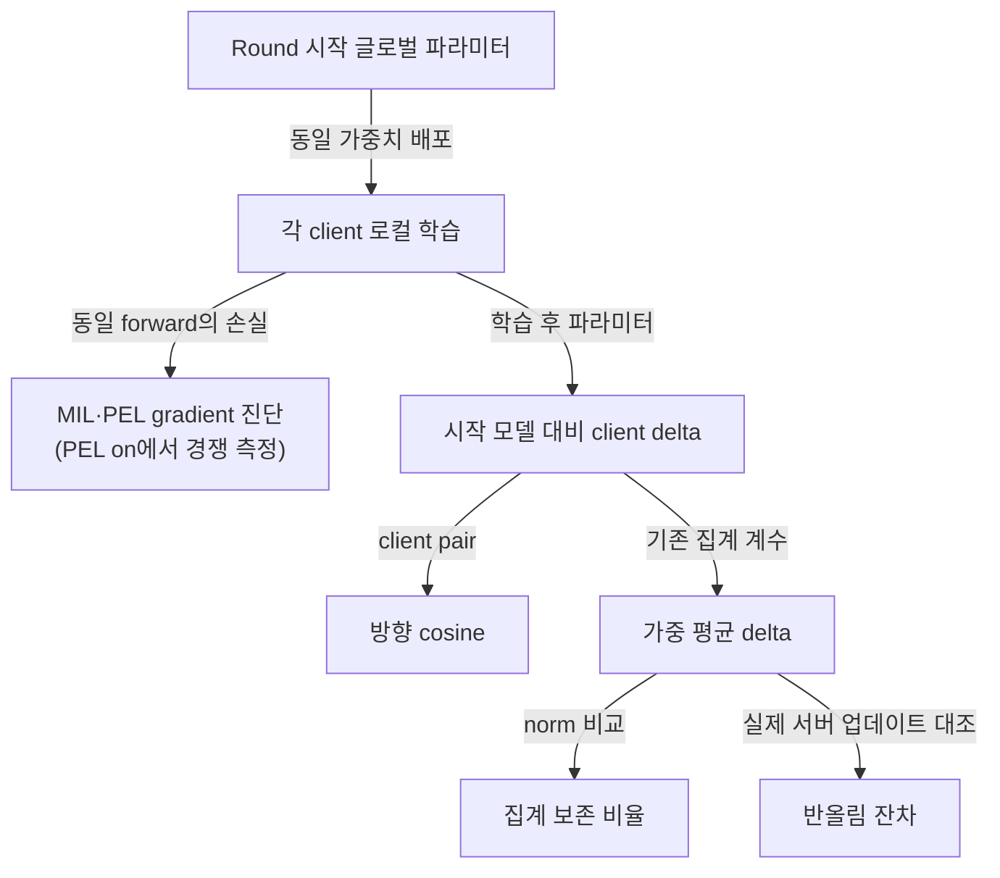

# 손실 경쟁과 업데이트 상쇄의 구분 및 event 기준 진단

> [!NOTE] 핵심 질문
>
> - 손실 값 비교만으로 업데이트 상쇄를 판단할 수 있는가?
> - 동일 client의 손실 경쟁과 client 간 업데이트 상쇄의 측정 차이?
> - PEL을 끈 event 기준 실행에서 확인된 현상과 미확인 원인?

- 기록일 / 갱신일: 2026-10-14
- 실험일: 2026-10-13 시작 폴더 시각 기준; 종료 시각 미제공
- 관련 트랙: 김배호 PEL 적용 지원
- 범위: UCF event, 13 clients, FedAvg, seed 88888888, PEL off 진단
- 코드 기준: cede515, manifest의 git_dirty=true; 변경 내용 미확인
- 근거: [실험 run002](../experiments/2026-10-13_ucf_event_baseline_run002.md), [원시 결과](../../artifacts/experiment-metrics/2026-10-13_ucf_event_baseline_fedavg_seed88888888_round20_run002/README.md), [진단 구현](../../utils/pel_diagnostics.py)

## 중요 개념

- **MIL 기반 분류 손실**: 각 client의 영상 단위 감독 목적; 별도의 연합학습 집계 손실과 구분
- **로컬 손실 경쟁**: 동일 batch·동일 시각 파라미터에 대한 MIL/PEL gradient의 방향 불일치
- **업데이트 상쇄**: 동일 글로벌 모델에서 출발한 client별 로컬 변화의 평균 과정에서 나타나는 벡터 크기 감소
- **집계 보존 비율**: 평균 업데이트 norm과 개별 업데이트 norm의 가중합 사이의 비율; 성능·정보 보존률과 구분
- **원인 검증 한계**: 손실 곡선·cosine·보존 비율의 관측은 진단 근거; 성능 저하의 인과관계 증명과 구분
- **용어 근거**: [논문 용어와 코드 식별자](../architecture/loss-terminology.md); 원시 로그의 기존 키 유지

## 측정 구조

- 집계·데이터 소유 경계: 기존 FedAvg 및 client 분할 유지
- 손실 gradient: rounds 1/5/10/15/20의 client별 첫 epoch 첫 batch; 전체 학습 분포의 표본
- 업데이트: 매 round, 전체 공유 파라미터 및 모듈별 flatten 벡터; 원본 특징 이동 없음

## 업데이트 상쇄 수식

$$
\Delta_i^{(r)}=\theta_i^{(r,\mathrm{local})}-\theta^{(r)},\qquad
a_i=\frac{b_i}{\sum_{j=1}^{K}b_j},\qquad
\bar\Delta^{(r)}=\sum_{i=1}^{K}a_i\Delta_i^{(r)}
$$

- $r$: 학습 round 인덱스
- $i,j$: client 인덱스
- $K$: 참여 client 수, 이번 실행 13
- $\theta^{(r)}$: round 시작 글로벌 파라미터 벡터
- $\theta_i^{(r,\mathrm{local})}$: client의 로컬 학습 후 파라미터 벡터
- $\Delta_i^{(r)}$: 공통 시작점 대비 client 업데이트
- $b_i$: 코드가 반환하는 정상·이상 DataLoader 배치 수의 합; 실제 optimizer step 수와 구분
- $a_i$: 합이 1인 기존 집계 계수
- $\bar\Delta^{(r)}$: client delta의 가중 평균

$$
R^{(r)}=\frac{\|\bar\Delta^{(r)}\|_2}
{\sum_i a_i\|\Delta_i^{(r)}\|_2},\qquad
c_{ij}^{(r)}=\frac{\langle\Delta_i^{(r)},\Delta_j^{(r)}\rangle}
{\|\Delta_i^{(r)}\|_2\|\Delta_j^{(r)}\|_2}
$$

- $R^{(r)}$: 집계 보존 비율; 작을수록 개별 크기에 비해 작은 평균 업데이트
- $c_{ij}^{(r)}$: client pair의 방향 cosine; 음수는 반대 방향 성분
- $\|\cdot\|_2$: 해당 공유 파라미터 또는 모듈을 flatten한 벡터의 L2 norm
- 0 분모: 결측 처리; pair cosine 0과 구분
- 주의: 직교 방향도 평균 norm 감소에 기여; 낮은 비율을 모두 반대 방향 충돌로 해석 금지

$$
C^{(r)}=\frac{\sum_{(i,j)\in V_r}a_i a_j c_{ij}^{(r)}}
{\sum_{(i,j)\in V_r}a_i a_j},\qquad
e^{(r)}=\|\Delta_{\mathrm{server}}^{(r)}-\bar\Delta^{(r)}\|_2
$$

- $V_r$: 두 norm이 0이 아닌 유효 client pair 집합, $i<j$
- $C^{(r)}$: 유효 pair의 계수 곱으로 정규화한 평균 cosine
- $\Delta_{\mathrm{server}}^{(r)}$: 실제 서버 집계 모델과 round 시작 모델의 차이
- $e^{(r)}$: 실제 집계와 double 정밀도 가중 delta 사이의 잔차; 손실 경쟁 지표와 구분
- $V_r$가 빈 경우: 평균 cosine 결측

## 로컬 손실 경쟁 수식

$$
g_M=\nabla_{\theta_v}\mathcal L_{\mathrm{MIL}},\quad
g_P=\nabla_{\theta_v}\mathcal L_{\mathrm{PEL}},\quad
c_{MP}=\frac{\langle g_M,g_P\rangle}{\|g_M\|_2\|g_P\|_2},\quad
q=\frac{\lambda\|g_P\|_2}{\|g_M\|_2}
$$

- $\theta_v$: 동일 forward에서 선택한 학습 가능 시각 파라미터; Temporal·위치 임베딩·선택적 projection
- $\mathcal L_{\mathrm{MIL}}$: MIL 기반 분류 손실
- $\mathcal L_{\mathrm{PEL}}$: 고정 의미 기준과의 PEL 정렬 손실
- $g_M,g_P$: 각 손실의 시각 gradient
- $c_{MP}$: 두 손실 gradient cosine; 음수는 해당 batch의 국소 경쟁
- $\lambda$: PEL 손실 계수
- $q$: 계수 반영 PEL/MIL gradient norm 비율
- 비활성 PEL: gradient norm 0, cosine null; 두 목적이 잘 정렬된다는 의미 없음
- 측정 방식: 추가 forward 없이 autograd.grad, 실제 optimizer gradient 보존

## 실제 관찰과 해석

공통 조건: UCF event, FedAvg, seed 88888888, 20 rounds × 10 local epochs, loader별 batch 64, LR 0.0001, PEL off. 아래는 전체 공유 파라미터 결과.

| Round | 보존 비율 | 가중 pair cosine | 음의 pair / 78 |
| --- | ---: | ---: | ---: |
| 1 | 0.509833 | 0.163042 | 0 |
| 5 | 0.313946 | -0.009358 | 30 |
| 10 | 0.447658 | 0.065709 | 18 |
| 15 | 0.391085 | 0.010676 | 19 |
| 20 | 0.447592 | 0.029125 | 12 |

- **관찰**: PEL 없이도 client 업데이트의 부분 상쇄·방향 불일치 존재; round 1은 음의 pair 없이 보존 비율 약 0.51
- **모듈 관찰**: round 5 Temporal 보존 비율 0.312310, 가중 cosine -0.010882; 전체 공유 결과만으로 각 모듈을 동일시하지 않음
- **모듈 결측**: global_text_prompt_embeddings의 delta norm 0; 보존 비율 및 cosine 결측
- **손실 관찰**: 지정된 5 rounds × 13 clients = 65개 gradient 표본 모두 pel_disabled
- **성능 관찰**: 최고 ROC 85.2737% (r18), 해당 AP 26.1676%; 독립 최고 AP 28.6585% (r19); 최종 ROC 85.2338%, AP 26.6568%
- **재현 관찰**: 이전 기준 실행의 20 rounds ROC/AP와 정확 일치; 테스트에서 최고 round 선택한 기존 정책 유지
- **해석 제한**: 보존 비율 하락과 일반화 성능의 인과관계 미확인; 단일 seed·dirty 작업 트리·데이터 checksum 부재
- **다음 비교**: event_pel의 동일 지표와 비교 후 PEL의 정렬·충돌 가능성 판단; scene 두 조건도 별도 비교 필요

## PEL 의미 정렬 손실 추가 후 이벤트별 클라이언트 비교

- 갱신일: 2026-10-14; [새 실행 기록](../experiments/2026-10-14_ucf_event_fixed_bank_pel_run002.md)
- 비교 조건: UCF-Crime 이벤트별 13 clients, FedAvg, seed 88888888, 20 rounds × 10 local epochs; PEL 의미 정렬 활성화만 의도한 변경
- 실제 대조 확인: 공통 학습 설정·client별 steps·클래스 사용 횟수 일치; 두 작업 트리의 소스·데이터 동일성은 완전 검증 불가

### 로컬 손실 경쟁 관찰

| Round | 전체 시각 gradient 평균 cosine | 음의 cosine / 13 clients | 평균 가중 PEL/MIL norm 비율 |
| --- | ---: | ---: | ---: |
| 1 | 0.518068 | 0 | 0.158155 |
| 5 | 0.664996 | 0 | 0.214017 |
| 10 | 0.647878 | 0 | 0.251370 |
| 15 | 0.583972 | 0 | 0.252349 |
| 20 | 0.427885 | 0 | 0.225758 |

- **관찰**: 전체 시각 파라미터와 Temporal 각각 65개 표본 모두 양의 cosine; 표의 평균은 client 산술평균, 반복 seed 통계와 구분
- **해석**: 측정 표본에서 반대 방향의 MIL–PEL gradient 경쟁 가설 미지지; PEL gradient 크기는 MIL의 약 0.16–0.25배인 round별 평균
- **제한**: 지정 round의 첫 batch만 측정; 전체 local epochs·모든 batch에서 경쟁이 없다는 주장 불가

### 클라이언트 업데이트 상쇄 관찰

| Round | 기준 집계 보존 비율 | PEL 집계 보존 비율 | 기준 음의 pair | PEL 음의 pair |
| --- | ---: | ---: | ---: | ---: |
| 1 | 0.509833 | 0.553449 | 0 | 0 |
| 5 | 0.313946 | 0.400459 | 30 | 12 |
| 10 | 0.447658 | 0.387902 | 18 | 16 |
| 15 | 0.391085 | 0.391392 | 19 | 19 |
| 20 | 0.447592 | 0.396725 | 12 | 20 |

- **관찰**: 전체 공유 파라미터 보존 비율의 기준 대비 증가 9 rounds, 감소 11 rounds
- **시간 구간 요약**: rounds 1–5 보존 비율 산술평균 기준 0.440826 → PEL 0.487749; rounds 16–20 기준 0.416787 → PEL 0.399094. 표시 구간의 기술 통계이며 seed 평균·유의성 검정과 구분
- **주의**: 음의 pair 수와 보존 비율은 서로 다른 통계; 방향·크기·가중치가 모두 평균 delta에 기여하므로 음의 pair 수만으로 상쇄량 해석 금지
- **성능 관찰**: 최고 ROC-AUC +0.9224%p, 최종 ROC-AUC -1.2358%p; 독립 최고 AP +1.0236%p, 최종 AP -1.3550%p
- **해석**: 초반 정렬 개선과 일부 후기 상쇄 증가 가능성; 모든 round에 일관된 완화·악화 근거 없음
- **원인 제한**: 로컬 첫-batch gradient 정렬과 여러 local steps 후 client 업데이트는 별개. 후기 성능 저하를 MIL–PEL 손실 충돌로 확정할 근거 부족
- **후속 범위**: 기존 1단계의 장면별 클라이언트 기준/PEL 진단은 미완료. 이 관찰만으로 손실 계수·적용 모듈·집계 변경을 확정하지 않음
- **환경 제한**: 기준 commit cede515, PEL commit a8b3f78, 양쪽 git_dirty=true; 데이터 checksum·변경 파일 목록 미제공

## 갱신 근거와 확인 기록

- [기준과 PEL 전체 round 비교](../experiments/2026-10-14_ucf_event_fixed_bank_pel_run002.md)
- [파생 통계 및 비교 JSON](../../artifacts/experiment-metrics/2026-10-14_ucf_event_fixed_bank_pel_fedavg_seed88888888_round20_run002/README.md)

- [측정값·조건·원시 로그 연결](../experiments/2026-10-13_ucf_event_baseline_run002.md)
- [통합 결과표](../experiments/results-summary.md)
- [1단계 실행 명세](../research/pel-stage1-diagnostic-spec.md)
- [5단계 전체 설명](2026-10-08_PEL_연합학습_5단계_실험구현.md)
- 확인: 20 rounds 연속성, 13 clients, 집계 계수 합, summary와 round 평가 일치, 원시 파일 SHA-256 기록
- Mermaid·수식: 정적 문법 확인; 실제 렌더 미검증
